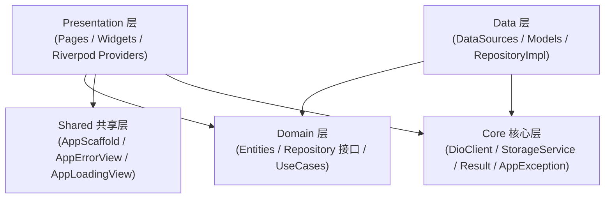
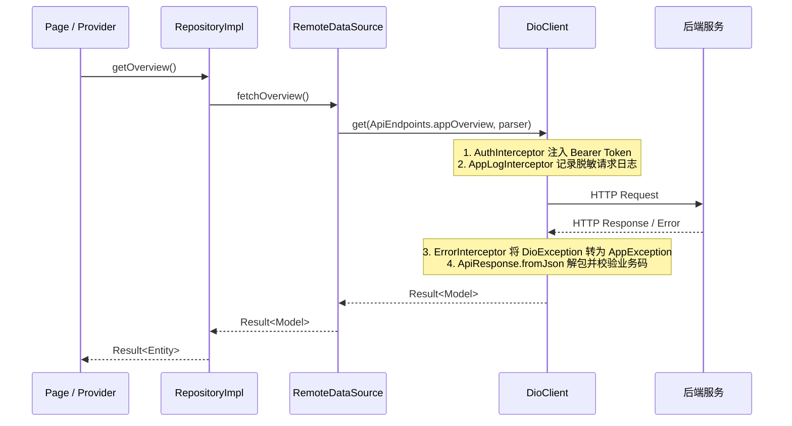

# 架构设计文档

本文档阐述本项目框架的整体分层架构、依赖方向约束、核心基础设施设计以及数据与状态流转规范，作为团队技术评审与日常开发的统一基准。

---

## 1. 整体架构选型：Feature-First + Clean Architecture

在中大型 Flutter 项目中，按“文件类型”组织目录（如全局 `pages/`、`models/`、`controllers/`）会随着业务增长导致模块边界模糊、文件跳转困难。因此本项目采用 **按业务功能优先（Feature-First）+ 整洁分层（Clean Architecture）** 的复合结构：

- **`core/`（核心基础设施层）**：与业务完全无关的底座能力（网络、存储、路由、日志、多环境、主题、异常、工具类）。
- **`shared/`（跨模块共享层）**：被 2 个及以上业务模块复用的通用 UI 组件或共享领域模型（如 `AppScaffold`、`AppErrorView`、`AppLoadingView`）。
- **`features/<feature_name>/`（业务功能模块层）**：高内聚的垂直业务切片，内部按三层拆分：
  - `domain/`：纯 Dart 领域层，定义业务实体（`Entity`）与仓储抽象接口（`Repository`），复杂业务可增加 `usecases/`。
  - `data/`：数据访问层，负责与后端 API 或本地缓存交互，包含 `datasources/`、`models/`（DTO）以及 `repositories/`（实现 Domain 接口）。
  - `presentation/`：表现层，负责页面渲染与交互状态管理，包含 `pages/`、`widgets/`（模块私有子组件）和 `providers/`（Riverpod 控制器）。

---

## 2. 依赖方向规则（严格红线）

### 强制约束
1. **`domain/` 层绝对纯净**：禁止导入 `package:flutter/...`、`package:dio/...` 或任何 `data/` 层文件，确保业务模型可脱离 UI 与框架独立演进和测试。
2. **禁止跨层直调**：`presentation/` 层的页面和控制器禁止直接调用 `DioClient` 或 `DataSource`，必须通过 `domain/repositories/` 定义的抽象接口获取数据。
3. **跨 Feature 解耦**：两个业务模块原则上不直接引用彼此的 `data/` 或内部私有组件；若确需共享能力，应下沉至 `shared/` 或通过路由传参 / Domain 接口通信。
4. **DTO 与 Entity 隔离**：`data/models/` 中的模型承载后端 JSON 字段映射；`domain/entities/` 中的实体仅保留客户端业务真正需要的字段，通过 `model.toEntity()` 完成转换，防止后端字段变更波及全量 UI 代码。

---

## 3. 核心基础设施设计

### 3.1 应用启动引导（`bootstrap.dart`）
所有环境入口（`main.dart`、`main_dev.dart`、`main_staging.dart`、`main_prod.dart`）统一调用 `bootstrap(EnvConfig)`，确保：
- `EnvConfig` 在所有模块初始化前就绪；
- `GlobalErrorHandler` 完成三层异常捕获（`FlutterError`、`PlatformDispatcher`、`runZonedGuarded`），且 Release 模式下自动替换默认红屏；
- `SharedPreferences` 在 `runApp` 前完成同步预热并通过 `ProviderScope.overrides` 注入，避免首屏因异步读取主题/语言配置产生闪烁。

### 3.2 统一错误处理与 `Result<T>`
基于 Dart 3 `sealed class` 构建了两套类型安全契约：
- **`AppException` 体系**：将网络断连、超时、401 未授权、5xx 服务端故障、后端业务错误码、数据解析失败统一抽象为有限子类，杜绝业务层直接 `catch (DioException)`。
- **`Result<T>` 封装**：由 `Success<T>` 与 `Failure<T>` 组成。
  - DataSource 与 Repository 统一返回 `Future<Result<T>>`，不向上抛出未受检异常；
  - Presentation 层若使用 Riverpod `AsyncNotifier`，可通过 `result.getOrThrow()` 交由 `AsyncValue.guard` 自动转为 `AsyncError`，并在 UI 中配合 `AppErrorView` 统一完成本地化错误文案展示与重试。

### 3.3 网络层设计（`core/network/`）

### 3.4 状态管理规范（Riverpod）
- **同步轻量全局状态**（如主题、语言）：使用 `NotifierProvider` + `Notifier<T>`。
- **异步加载与交互状态**（如列表、详情、提交）：使用 `AsyncNotifierProvider` + `AsyncNotifier<T>`。
- **依赖注入与单例服务**（如 `DioClient`、`StorageService`、`Repository`）：使用只读 `Provider<T>`，且尽量对外暴露抽象接口类型，方便测试中一键 `overrideWithValue`。
- **禁止在 `build()` 中执行副作用**：页面内仅用 `ref.watch` 订阅渲染状态，点击事件等操作统一使用 `ref.read(...notifier).doSomething()`。

### 3.5 存储隔离策略
| 存储类型 | 实现类 | 适用数据 | 严禁存储 |
| :--- | :--- | :--- | :--- |
| 普通 KV 存储 | `StorageService` (`SharedPreferences`) | 主题模式、语言偏好、引导页状态、非敏感草稿 | Token、密码、身份证号等敏感信息 |
| 加密安全存储 | `SecureStorageService` (`FlutterSecureStorage`) | AccessToken、RefreshToken、加密凭据 | 大体积列表缓存（性能开销大） |

---

## 4. 可选演进方向

当前模板刻意保持 **零强耦合代码生成依赖**（除 Flutter 官方内置的 `gen-l10n` 外），确保克隆后可直接 `flutter pub get && flutter run`。当业务模型数量超过 30+ 时，团队可按需平滑引入：
- `freezed` + `json_serializable` + `build_runner`：自动生成不可变实体、`copyWith`、`==/hashCode` 与 JSON 序列化代码；
- `riverpod_annotation` + `riverpod_generator`：使用 `@riverpod` 注解声明 Provider；
- `drift` 或 `isar`：离线优先或复杂关系型本地数据库；
- `sentry_flutter` / `firebase_crashlytics`：在 `GlobalErrorHandler.reportError` 中一键接入线上崩溃监控。
